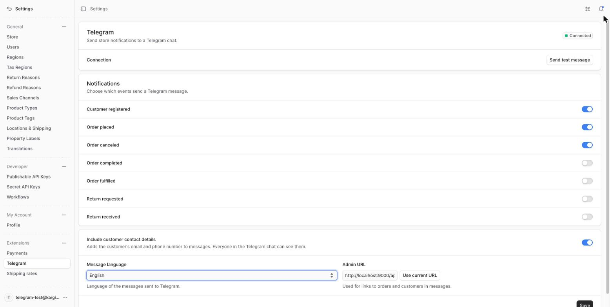

# @nkavt/medusa-plugin-telegram

[](https://github.com/nkavt/medusa-plugin-telegram/actions/workflows/ci.yml)

Telegram notifications for Medusa v2. The seller gets a Telegram message when a customer registers, an order is placed, canceled, prepared for shipping, returned, and more. From the admin you choose which events are sent, the message language, and whether customer contact details (email and phone) are included.

```
🛒 New order #1042

Customer: John Doe
Email: john@example.com
Phone: +995 555 00 00 00
Total: GEL 120.50
🔗 Open in admin
```

With *Include customer contact details* turned off, the email and phone lines are left out:

```
🛒 New order #1042

Customer: John Doe
Total: GEL 120.50
🔗 Open in admin
```

## Features

- Events configurable from **Settings → Telegram** in the admin
- Messages in every Medusa Admin language **plus Georgian (ქართული)**
- Admin UI follows the admin user's dashboard language
- Order total formatted in the order's currency and the message language
- "Open in admin" link to the order/customer — the admin URL is detected from the settings page, no env var needed
- "Send test message" button to verify the bot/chat setup
- Switch to leave customer email/phone out of messages
- Sending never breaks the store flow: failures are logged with the reason and skipped

## Supported events

| Event | Default |
|---|---|
| `customer.created` (registration) | on |
| `order.placed` | on |
| `order.canceled` | on |
| `order.completed` | off |
| `order.fulfillment_created` | off |
| `order.return_requested` | off |
| `order.return_received` | off |

## Installation

Requires Medusa **v2.19.0 or newer** (v2.x).

```bash
npm install @nkavt/medusa-plugin-telegram
```

```ts
// medusa-config.ts
module.exports = defineConfig({
  // ...
  plugins: [
    {
      resolve: "@nkavt/medusa-plugin-telegram",
      options: {
        botToken: process.env.TELEGRAM_BOT_TOKEN,
        chatId: process.env.TELEGRAM_CHAT_ID,
        // optional - fallback for links until the URL is saved in the admin
        // adminUrl: "https://shop.example.com/app",
      },
    },
  ],
})
```

```bash
npx medusa db:migrate
```

### Getting the token and chat ID

1. Create a bot with [@BotFather](https://t.me/BotFather) and copy the token → `TELEGRAM_BOT_TOKEN`.
2. Add the bot to your group/channel (or start a private chat with it) and send any message.
3. Open `https://api.telegram.org/bot<TOKEN>/getUpdates` and copy `chat.id` → `TELEGRAM_CHAT_ID` (group IDs are negative, e.g. `-1001234567890`).

If either option is missing, the plugin logs a warning on startup and stays inactive.

## Admin settings

**Settings → Telegram**:



- **Connection** – shows whether the token/chat ID are set; *Send test message* sends a message and shows Telegram's error if it fails (e.g. `chat not found`).
- **Notifications** – toggle each event.
- **Include customer contact details** – adds the customer's email and phone to messages (on by default). Turn it off if the chat is shared with people who shouldn't see customer data; messages then show the name, total and admin link only.
- **Message language** – defaults to your admin language on first save.
- **Admin URL** – prefilled from the current page; used for "Open in admin" links. Links to non-public hosts (like `localhost`) are sent as plain text, because Telegram may refuse them as inline links.

## Privacy

Telegram bot messages are not end-to-end encrypted and are visible to everyone in the chat. Customer names, emails and phone numbers are personal data, so mention Telegram in your privacy policy if you send them, or disable *Include customer contact details*.

## Error handling

Notifications run in a subscriber and never throw. Any failure (Telegram API error, timeout, missing order, …) is logged:

```
error: [telegram] Failed to send "order.placed" notification for order_01J...: Telegram API error 403: Forbidden: bot was kicked from the group chat
```

Requests to Telegram time out after 10 seconds.

## Translations

- Message strings: `src/modules/telegram/messages/locales/<code>.ts`
- Admin strings: `src/admin/i18n/json/<code>.json` (namespace `telegram`)

Language codes match the Medusa Admin dashboard (`en`, `de`, `ptBR`, `zhCN`, …) plus `ka`. To add a language, add a file in both folders, register it in `messages/locales/index.ts`, `messages/languages.ts` and `src/admin/i18n/index.ts`.

## Development

```bash
npm install
npm run build       # medusa plugin:build
npm run lint
npm run typecheck   # admin UI + test files
npm run dev         # medusa plugin:develop (publishes to local yalc registry)
```

### Tests

```bash
npm run test:unit                  # messages, locales, service, subscriber, validation
npm run test:integration:modules   # settings module + workflow against Postgres
```

Integration tests create a temporary database, so they need a reachable Postgres via `DB_HOST`, `DB_PORT`, `DB_USERNAME` and `DB_PASSWORD`. For example:

```bash
docker run --rm -d --name medusa-test-pg -p 5432:5432 -e POSTGRES_PASSWORD=postgres postgres:16-alpine
DB_USERNAME=postgres DB_PASSWORD=postgres npm run test:integration:modules
```

CI (`.github/workflows/ci.yml`) runs lint, typecheck, build, unit and integration tests on every pull request and on pushes to `main`.

In a Medusa app: `npx medusa plugin:add @nkavt/medusa-plugin-telegram`, then add it to `plugins` in `medusa-config.ts`.

Migrations: `npx medusa plugin:db:generate` (needs `DB_HOST`/`DB_PORT`/`DB_USERNAME`/`DB_PASSWORD` for a reachable Postgres).
